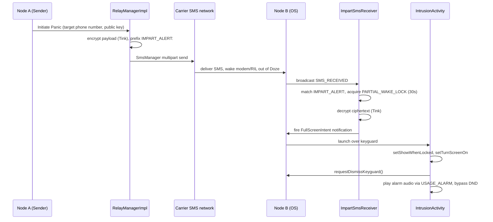

<!-- Engineered by uncoalesced -->
# Architecture & Technology Stack

---

## 1. Technology Stack

| Layer | Choice | Notes |
|---|---|---|
| Platform | Native Android | Min SDK 26 (Android 8.0 Oreo), Target SDK 34+ |
| Language | Kotlin | 100% Kotlin, no Java interop by design |
| UI Toolkit | Jetpack Compose | Exclusively. No XML layouts, no Fragments |
| Dependency Injection | Dagger Hilt | `@HiltAndroidApp`, `@AndroidEntryPoint`, `@Inject` constructor injection |
| Transport / Signaling | **Encrypted SMS only** (`SmsManager` send, `SMS_RECEIVED` `BroadcastReceiver`) | No Firebase, no Cloud Functions, no Google delivery path |
| Backend / Logic | **None** | Peer-to-peer over the carrier SMS channel; there is no server |
| Local Storage (structured) | Room Database, encrypted via SQLCipher | Stores the Contact Matrix |
| Local Storage (key-value) | EncryptedSharedPreferences | Stores session flags, the node UUID, and the node's own phone number |
| Auth | None | Identity is a locally generated UUID; trust is established only by the physical QR handshake |

## 2. Architectural Style: Event-Driven, OS-First

Impart is built around a single governing constraint: **the app cannot be trusted to be running.** Android will suspend it, Doze it, or kill it. Any architecture that assumes otherwise is already broken.

The solution is an Event-Driven Architecture (EDA) where the *event* — an incoming SMS — is capable of resurrecting the app from a fully stopped state. The flow is OS-first: the operating system, not the application, is the thing waking up. The application is just what runs once the OS has already done the hard part.



## 3. Why SMS, Not a Push Relay

This is the single most important transport decision in the system, so it's worth being explicit about why.

The doctrine is **no third-party delivery infrastructure in the loop, at all.** A push relay (FCM or otherwise) means Google's servers see who paged whom and when, decide whether and when to deliver, and can throttle or drop the message. For an emergency tool that is an unacceptable dependency and an unacceptable metadata leak.

**SMS is a peer-to-peer carrier primitive.** An incoming SMS is delivered by the modem/RIL and raises the `SMS_RECEIVED` broadcast on the receiver even when the app is killed or the device is in Doze — the same wake path an ordinary text uses, which no app-level battery optimizer can suppress. Impart carries only ciphertext in the message body (`IMPART_ALERT:` + Tink output), so the carrier relays an opaque text and never sees plaintext. `ImpartSmsReceiver` matches the prefix and hands control back to Impart's own code the instant the SMS arrives, which is what guarantees the WakeLock → FullScreenIntent → Alarm-Audio chain actually fires.

Trade-offs, stated honestly: SMS requires a SIM with an SMS plan and cellular coverage; delivery latency is typically 1–5 s but is carrier-dependent and not guaranteed; and because Impart is not the default SMS app, it cannot `abortBroadcast()`, so the ciphertext SMS also lands in the stock Messages inbox on the receiver. These are accepted costs of removing every server from the path.

## 4. The Intrusion Pipeline — Mechanic by Mechanic

### 4.1 Ingress: `RelayManagerImpl` → `SmsManager`

`RelayManagerImpl.dispatchPanic` runs entirely on the sender's device: it builds the plaintext payload (type, urgency, the sender's own phone number and public key for the return ACK, optional lat/lng), Tink-encrypts it to the target contact's public key looked up from the Contact Matrix, prefixes `IMPART_ALERT:`, splits it with `divideMessage`, and sends it with `SmsManager.sendMultipartTextMessage` to the contact's phone number. There is no ingress server — the "network" is the carrier's SMS channel.

### 4.2 The Brain: `ImpartSmsReceiver`

`ImpartSmsReceiver` is a `BroadcastReceiver` registered for `android.provider.Telephony.SMS_RECEIVED`. `onReceive` reassembles the multipart message body and, if it starts with `IMPART_ALERT:`, begins the entire intrusion sequence. Its responsibilities, in strict order:

1. Match the `IMPART_ALERT:` prefix (ignore everything else) and best-effort `abortBroadcast()`.
2. Acquire a wake lock (below).
3. Decrypt the ciphertext (Tink); reject on failure.
4. Build and fire the full-screen-intent notification (PANIC), or surface an ACK notification.

### 4.3 WakeLock Acquisition

```kotlin
val wakeLock = powerManager.newWakeLock(
    PowerManager.PARTIAL_WAKE_LOCK,
    "Impart::IntrusionWakeLock"
).apply { acquire(30_000L) } // 30s timeout — enough to build and fire the intent, not a second longer
```

A `PARTIAL_WAKE_LOCK` keeps the CPU running without necessarily lighting the screen — screen-on is handled separately, deliberately, via the full-screen intent flags on the activity itself. The 30-second timeout is a safety valve: if something in the decrypt/build pipeline hangs, the wake lock releases itself rather than draining the battery indefinitely.

### 4.4 The Bypass: `FullScreenIntent`

```kotlin
val pendingIntent = PendingIntent.getActivity(
    context, 0, intrusionIntent,
    PendingIntent.FLAG_UPDATE_CURRENT or PendingIntent.FLAG_IMMUTABLE
)

val notification = NotificationCompat.Builder(context, CHANNEL_ID)
    .setContentTitle("IMPART — PANIC")
    .setPriority(NotificationCompat.PRIORITY_MAX)
    .setCategory(NotificationCompat.CATEGORY_ALARM)
    .setFullScreenIntent(pendingIntent, true)
    .build()
```

`setFullScreenIntent(pendingIntent, true)` is the Android-sanctioned mechanism for launching an activity directly over the lock screen — the same API used by incoming call screens and alarm clock apps. It requires the `USE_FULL_SCREEN_INTENT` manifest permission, already granted in the current build. As of Android 14 (API 34), this permission is auto-granted at install only to apps the Play Store categorizes as calling/alarm apps; other apps require the user to manually enable it via Settings. This is a real risk to track as Impart moves past sideloading on your own devices toward any wider distribution — see `06_ROADMAP_AND_NEXT_STEPS.md`.

### 4.5 The Face: `IntrusionActivity`

```kotlin
override fun onCreate(savedInstanceState: Bundle?) {
    super.onCreate(savedInstanceState)
    setShowWhenLocked(true)
    setTurnScreenOn(true)
    val keyguardManager = getSystemService(KEYGUARD_SERVICE) as KeyguardManager
    keyguardManager.requestDismissKeyguard(this, null)
    setContent { IntrusionScreen(...) }
}
```

`setShowWhenLocked(true)` and `setTurnScreenOn(true)` are the modern (API 27+) replacements for the deprecated `FLAG_SHOW_WHEN_LOCKED` / `FLAG_TURN_SCREEN_ON` window flags. `requestDismissKeyguard()` attempts to dismiss an insecure keyguard outright; on a secure keyguard (PIN/pattern/biometric) it surfaces the activity above the lock screen but still requires the user to authenticate to fully unlock the device — the intrusion screen renders regardless, which satisfies the "undeniable alert" requirement even if full device unlock still needs a PIN.

### 4.6 Audio Override: `USAGE_ALARM`

```kotlin
val audioAttributes = AudioAttributes.Builder()
    .setUsage(AudioAttributes.USAGE_ALARM)
    .setContentType(AudioAttributes.CONTENT_TYPE_SONIFICATION)
    .build()
```

Routing playback through `USAGE_ALARM` places it in the same audio stream category as the device's own alarm clock — a stream Android's Do Not Disturb implementation deliberately does not silence, on the reasoning that a sleeping user still needs their alarm to go off. Impart borrows this same guarantee rather than fighting the OS.

## 5. Doze Mode & OEM Battery Management — Honest Caveats

Incoming SMS wakes the modem/RIL and raises `SMS_RECEIVED` even under **stock Android's** Doze Mode — this is the core reason SMS was chosen over a push relay. It does **not** automatically survive every OEM's custom battery management layer, which can still deny a backgrounded app the CPU/autostart it needs to run the receiver to completion. Be upfront about this, because it's a real gap:

- **Xiaomi (MIUI/HyperOS)** and other Chinese OEM skins aggressively kill background apps and require the user to manually disable battery restrictions and enable "Autostart" for Impart.
- **Samsung (One UI)** has historically applied similar restrictions under "Put unused apps to sleep" / "Deep sleeping apps" lists.
- Impart's onboarding flow should detect the device manufacturer and, where possible, deep-link the user directly to the relevant OEM battery-exemption settings screen — a well-known pattern (see the open-source "Don't kill my app" project's per-OEM intent list for reference).

Separately, SMS delivery depends on a SIM with SMS service and cellular coverage; there is no data/Wi-Fi fallback by design (that would put a server back in the loop). Impart should not overstate its reliability guarantee on non-stock OEM skins, or where there is no cellular signal, until this onboarding step exists.

## 6. Dependency Injection Topology

Hilt modules should be scoped as follows:

- `AppModule` (SingletonComponent) — provides `PowerManager` (and other framework singletons as needed).
- `DatabaseModule` (SingletonComponent) — provides the encrypted Room database and its DAOs.
- `CryptoModule` (SingletonComponent) — provides the Android Keystore-backed key manager and the AES-GCM cipher wrapper.
- `NetworkModule` (SingletonComponent) — binds `RelayManager` to `RelayManagerImpl`, the SMS transport. (Named "Network" for historical reasons; there is no network client — it is the SMS dispatcher.)

Each is expanded further in `04_FILE_STRUCTURE_AND_STATE.md`.
