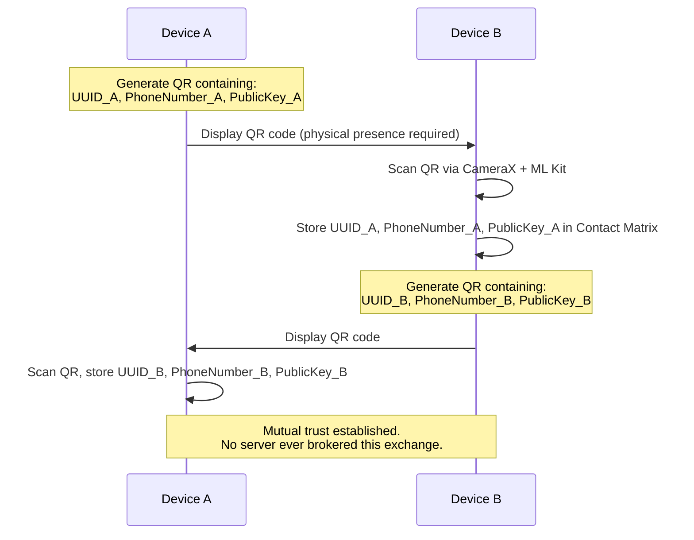

<!-- Engineered by uncoalesced -->
# Security protocol: trust no one

---

## 1. Threat Model & Trust Doctrine

Impart's security posture starts from an uncomfortable but necessary premise: **the infrastructure carrying the message is not trusted with its contents.** The transport is the carrier SMS channel (the mobile network operator and any SS7 intermediary) and it is treated as a dumb relay, not a confidant. It is trusted to move ciphertext from A to B. It is never trusted to see plaintext. There is deliberately no Google infrastructure (no Firebase, no Cloud Functions, no FCM) anywhere in the delivery path.

This has a concrete implication for every design decision downstream: if a piece of data would be meaningful to an attacker (or to the carrier itself) in plaintext, it must never exist in plaintext outside the sender's and receiver's devices.

## 2. Identity Layer: UUIDs

Every node in Impart is identified by a version-4 UUID, generated locally on first launch and never reused. The UUID is:

- **Not derived from personal information.** No phone number, no email, no device serial.
- **Immutable** once created. A new UUID means a new identity, with all existing trust relationships requiring re-establishment.
- **Meaningless without a corresponding trust record.** Possessing someone's UUID alone grants no capability; it must be paired with the public key and phone number exchanged during the handshake below.

## 3. The Handshake Protocol

Trust in Impart is never established remotely. It is established through a single, deliberate, physical act: **scanning a QR code.**



The QR payload contains exactly three fields: the presenting device's UUID, its phone number (the SMS destination a counterpart will page), and its Tink public key (see §4.4). Because a device cannot reliably read its own number from the SIM, the phone number is entered by the user on the My QR screen and persisted locally. This is a two-way exchange; both devices must scan each other's codes for the trust relationship to be bidirectional, meaning either party can page the other.

**Why out-of-band matters:** because the exchange never touches any server, there is no remote code path (no API call, no server, no database write) that can silently add a contact. Adding someone to your Contact Matrix requires their device to be physically present and cooperating. This closes off the entire class of "attacker adds themselves as a trusted contact remotely" attacks by construction, not by policy.

## 4. End-to-End Encryption Pipeline

### 4.1 Key Generation & Storage

Each device generates its own X25519 keypair on first launch (§4.4). The **private key never leaves the device** and is stored exclusively in the **Android Keystore system**, meaning the wrapping key is generated inside the device's secure hardware element and, on supporting hardware, is never extractable from it. The public key is the only half that travels, via the QR handshake in §3.

### 4.2 Message Envelope Structure

Every payload sent between nodes, whether a panic or a future richer message type, is wrapped by Tink before it is handed to the SMS transport. Conceptually the envelope is:

```json
{
  "senderUuid": "b3f1...-uuid",
  "nonce": "base64-96-bit-IV",
  "ciphertext": "base64-AES-256-GCM-output",
  "authTag": "base64-GCM-tag",
  "timestamp": 1751234567
}
```

- **`nonce`**: a freshly generated 96-bit initialization vector, unique per message. Reusing a nonce with the same key catastrophically breaks GCM's confidentiality guarantee, so this must be cryptographically random per send, never a counter that could collide across app reinstalls.
- **`ciphertext`**: the actual payload (e.g. `{"type": "PANIC", "message": "..."}`), encrypted under AES-256-GCM using key material derived from the handshake.
- **`authTag`**: GCM's built-in authentication tag, which lets the receiver detect any tampering with the ciphertext in transit and reject the message outright rather than decrypt corrupted or forged data.
- **`timestamp`**: reserved for replay mitigation (§6). Not yet carried by the current build.

### 4.3 Encryption / Decryption Pipeline

**Send path:** plaintext payload → JSON-serialize → AES-256-GCM encrypt (fresh nonce, key from the Contact Matrix record) → base64-encode → prefix `IMPART_ALERT:` → `SmsManager.sendMultipartTextMessage` to the contact's phone number → carrier SMS.

**Receive path:** `ImpartSmsReceiver.onReceive()` → match the `IMPART_ALERT:` prefix and strip it → Tink decrypt and verify the auth tag → look the `senderPublicKey` carried inside the payload up in the Contact Matrix → alarm only if it is there. A failed decrypt, a malformed payload, and an unknown sender each produce a visible status notification and no alarm. The `senderPhoneNumber` in the payload is where the return ACK goes.

### 4.4 Key-agreement scheme (settled)

The code uses Tink's hybrid public-key encryption with the `DHKEM_X25519_HKDF_SHA256_HKDF_SHA256_AES_256_GCM` template (HPKE, RFC 9180). Each node has a long-term X25519 keypair; every message derives a fresh shared secret with an ephemeral key, so the QR carries only a public key and observing the scan does not let anyone decrypt anything. The pre-shared-secret alternative was rejected for exactly that reason. `ContactEntity` stores the counterpart's serialized public keyset in `publicKeyBase64`.

Not implemented: sender authentication at the crypto layer. The receiver trusts the `senderPublicKey` field inside the decrypted payload and checks it against the Contact Matrix; anyone holding a recipient's public key could forge that field. Closing this needs a signature (Tink `PublicKeySign`) added to the handshake and payload, and is on the roadmap.

## 5. What the Server Can and Cannot See

Being explicit about this is a security requirement in itself. An honest threat model does not overclaim.

**The carrier (and any SMS/SS7 intermediary) can see:**
- That the sender's number texted the receiver's number, and when.
- The size of the message (number of SMS parts).
- Both parties' phone numbers. These are the routing addresses and are inherently visible to the network. This is a real metadata exposure, and a stronger identifier than an opaque token because a phone number ties to a subscriber identity.

**The carrier cannot see:**
- The plaintext content of any message (the body is `IMPART_ALERT:` + Tink ciphertext).
- The nature of the alert (panic vs. a future non-emergency message type, if those are ever added).

This means Impart provides **confidentiality of content**, not **metadata privacy**, and over SMS the metadata (both real phone numbers, timing) is arguably more exposing than a push token would be. State that distinction plainly to anyone relying on the system, rather than implying it away. The trade accepted here is metadata visibility to the carrier in exchange for removing Google entirely from the loop and gaining a Doze-proof, server-free wake path.

## 6. Attack Surface & Mitigations

| Threat | Mitigation |
|---|---|
| Replay attack (attacker re-sends a captured envelope) | `timestamp` checked against a tolerance window (e.g. ±2 minutes) on receipt; stale envelopes are discarded |
| Phone-number change / device loss | Trust records support **revocation**. Removing a contact from the Contact Matrix stops your panics going to them and stops theirs raising your alarm, because the receiver checks the sender's key. A lost/stolen device (or a reassigned number) should trigger the owner to manually revoke its UUID from all counterpart Contact Matrices, since there's no central authority to do this for them. Note the SIM/number is a recycled identifier: if a number is reassigned to a stranger, stale contacts would page the wrong handset until revoked (the payload still won't decrypt without the private key) |
| Man-in-the-middle during handshake | Mitigated structurally. The handshake requires physical co-presence for the QR scan, a stronger channel-authentication guarantee than any remote key-exchange protocol alone |
| Ciphertext tampering in transit | GCM authentication tag; any modification causes decryption to fail closed, not open |
| Private key extraction | Android Keystore-backed storage; on devices with a TEE or StrongBox, key material is not extractable even with root access |

## 7. Key Rotation & Revocation

Because Impart has no central identity authority by design, key rotation is a **manual, mutual re-handshake**: if a device's keypair is rotated (e.g. after a suspected compromise), every counterpart relationship must be re-established via a fresh QR exchange. This is a deliberate tradeoff. It sacrifices convenience for the guarantee that trust always traces back to a physical, verifiable act between two humans.
