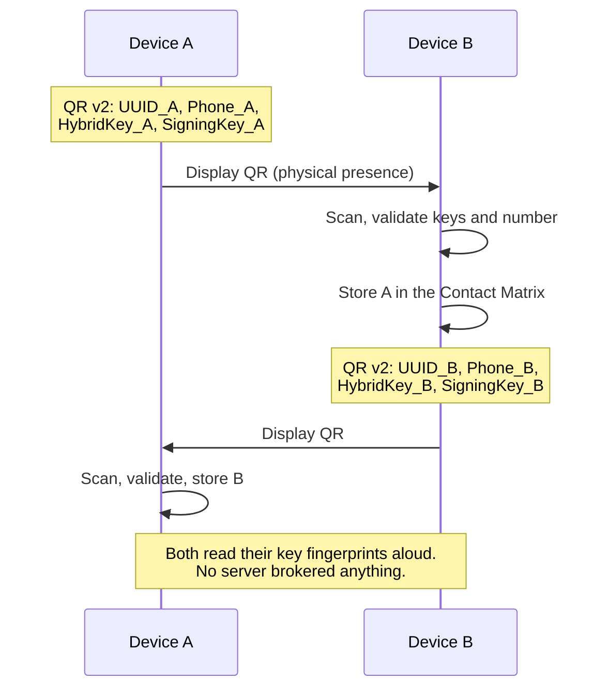

<!-- Engineered by uncoalesced -->
# Security protocol: trust no one

---

## 1. Threat model

The network carrying a message is not trusted with its contents. Impart's transport is the carrier SMS channel: the mobile operator and any SS7 intermediary. It is trusted to move ciphertext from A to B and nothing else. There is no Google infrastructure (no Firebase, no Cloud Functions, no FCM) and no Impart server anywhere in the path.

So anything that would mean something to an attacker, or to the carrier, never exists in plaintext outside the two phones. And because anyone who knows a phone number can text it, the receiving phone treats every incoming alert as hostile until it proves otherwise.

## 2. Identity

Every node has a version-4 UUID, generated on first launch. It is not derived from a phone number, email or device serial. A new UUID is a new identity, and every pairing has to be redone.

A node also holds two Tink keysets, both generated on first launch:

- A hybrid keyset (HPKE: X25519, HKDF-SHA256, AES-256-GCM). Alerts to this node are encrypted to its public half.
- A signing keyset (Ed25519). Every alert this node sends is signed with it.

Both keysets are stored in app-private preferences, encrypted by an AES key that lives in the Android Keystore (in secure hardware where the phone has it). The keysets are decrypted into app memory when used. The public halves travel in the QR code. The private halves never leave the phone.

### 2.1 The lock

The app lock asks for a PIN on every process start and after 30 seconds in the background. Two PINs exist: the standard PIN opens the app, the duress PIN wipes it (section 6, A6). Neither is stored.

- `KeystorePinHasher` holds a non-exportable HMAC-SHA256 key under the alias `impart_pin_mac`. StrongBox is requested first and the TEE is the fallback. The key can sign and nothing else; it cannot be read out, so an attacker with a copy of the preferences file and the master key still has to ask this phone's hardware for every guess.
- For each PIN `PinVerifier` stores a random 16-byte salt and `HMAC(key, salt || pin)` in the encrypted preferences (`SecurePrefsManager` implements `PinStore`). The same PIN gives different records on different phones and after every change.
- A candidate is checked against both records on every call with `MessageDigest.isEqual`, so the comparison takes the same time whether the first digit was right or not.
- The published defaults 1234 and 9999 are only a refusal list at setup. No read path falls back to them. Until the user has chosen PINs, nothing unlocks and nothing wipes.
- Builds before November 2026 stored the PINs as strings. On first run of the new code the plaintext values are hashed and removed in the same preferences commit.
- The duress wipe deletes the HMAC key, so even an intact record can never be verified again.

PIN digits travel through the app as character arrays that are zeroed after use (T06). The JVM may still copy them; that is a reduction of exposure, not a guarantee.

### 2.2 Lockouts

Four wrong PINs are free. From the fifth, the lock refuses PINs for 30 seconds, doubling each time up to 15 minutes. The counters are built to survive the obvious ways of resetting them:

- The failed count and the remaining wait are written with a synchronous commit before the lock screen hears the answer, so force-stopping the app right after a wrong guess still counts it.
- The wait is measured on `SystemClock.elapsedRealtime()`, which keeps counting through deep sleep and cannot be set by the user. The wall clock is recorded but never used to shorten a wait, so setting the date back or forward changes nothing.
- The boot count (`Settings.Global.BOOT_COUNT`) is stored with the wait. On a different boot the elapsed clock has restarted, so the lock resumes the full remaining wait and re-anchors it on the new boot. A reboot can only lengthen a lockout.
- Only a correct standard PIN or the first PIN setup clears the counter. Nothing else in the app touches it; wiping the app's data is the only other way.
- The duress PIN is checked before the lockout, so it works at any time.
- Optional hard cap (Joel, 2026-11-04): Settings has "Wipe after 20 wrong PINs", off by default and changed only behind the standard PIN. When on, the twentieth consecutive failure runs the duress wipe. With the lockouts in front of it, reaching twenty takes more than two hours of holding the phone.

## 3. The handshake

Trust is established one way only: scanning a QR code in person.



The QR payload is `{v: 2, uuid, phoneNumber, publicKey, signingKey}`. The phone number is typed in by the user on the My QR screen, because Android cannot read it reliably from the SIM. It has to be a full international number (`+`, country code, 8 to 15 digits). Short codes and local formats are refused on both sides, so a QR cannot point panics, or the automatic dead man's switch, at a premium-rate number.

When a QR is scanned:

- A v1 QR (no signing key) is refused with "update both phones".
- Keys that Tink cannot parse as the right type are refused.
- The node's own QR is refused.
- A new UUID is added.
- A known UUID with the same keys is a re-pair. The nickname is kept, the number is updated, and a revoked contact becomes active again.
- A known UUID with different keys is not written. The user sees a dialog with the old and new key fingerprints and decides. That is what a reinstall looks like, and it is also what a QR built to hijack an existing contact looks like.

Each node shows an 80-bit key fingerprint (SHA-256 over both public keys, five groups of four hex digits) under its QR and next to every contact. Reading it aloud while pairing confirms the QR really came from the phone in front of you.

Pairing is two-way: both phones scan each other.

## 4. Alerts

### 4.1 Payload

The plaintext of every alert, panic or acknowledgement, is a small JSON object with short keys to fit the SMS budget:

```json
{"v":2,"t":"P","from":"<sender uuid>","to":"<recipient uuid>","id":"<128-bit random, base64url>","ts":1790253160570,"lat":51.5,"lng":-0.12}
```

- `t` is `P` for a panic or `A` for an acknowledgement. An acknowledgement carries `ack`, the ID of the panic it answers.
- `lat` and `lng` are present only when the sender turned on location sharing.
- There is no phone number or public key in the payload. The receiver uses what it stored at pairing.

### 4.2 Sign, then encrypt

Send path:

1. Serialize the payload once. That string is the payload from here on.
2. Sign its UTF-8 bytes with the sender's Ed25519 key.
3. Join as `<base64 signature>.<payload>`.
4. Encrypt that to the recipient's hybrid public key with Tink HPKE.
5. Base64, prefix `IMPART_ALERT:`, and send as a multipart SMS from the default SMS SIM, with a sent-intent per part.

A worst-case panic, with coordinates at full precision, fits in four SMS parts. A unit test enforces this.

The signature covers the exact bytes that travel, so the receiver verifies what was sent and nothing is re-serialized. Encryption comes last, so the carrier sees neither the payload nor who signed it.

### 4.3 Receive path

`ImpartSmsReceiver` matches the prefix and ignores every other SMS. It does nothing at all if the node was wiped. Then, under `goAsync()` and a 30-second wake lock, `AlertVerifier` decides:

1. Decrypt with this node's hybrid key. Failure: unreadable.
2. Split the signature from the payload. A bare JSON plaintext is a v1 alert: outdated.
3. Parse the payload. Failure: malformed.
4. Find the sender by `from` among active contacts. Missing or revoked: unknown sender.
5. Verify the signature with the signing key stored for that contact. Failure: bad signature, which means someone is impersonating them.
6. Check `to` is this node. Otherwise: not for this node. This stops a trusted contact forwarding a third node's signed alert.
7. Check the time. More than 10 minutes in the future: rejected. More than 24 hours old: stale, reported and not raised.
8. Record `id` in the seen-alerts table. Already there: replayed.
9. Accepted. A panic raises the full-screen alarm and shows the delay if it arrived late. An acknowledgement posts a notification.

Every verdict other than acceptance posts a visible status notification. Nothing about the payload is trusted until step 5 passes, and an ID is only recorded once the alert has passed every other check.

The acknowledgement goes back to the contact's stored phone number, encrypted to the contact's stored key. Nothing in the incoming alert decides where it goes.

### 4.4 Why these primitives

HPKE gives every message a fresh ephemeral key, so a QR only carries public keys and watching the scan does not let anyone decrypt anything. The pre-shared-secret alternative was rejected for exactly that reason. HPKE alone does not authenticate the sender, because anyone with the recipient's public key can encrypt to it. That is why every alert is also signed with Ed25519, and why the verifier checks the signature against the key stored at pairing, never a key named inside the message.

## 5. What the carrier can and cannot see

This section is a security requirement in itself. An honest threat model does not overclaim.

The carrier, and any SMS or SS7 intermediary, can see:

- That the sender's number texted the receiver's number, and when.
- How many SMS parts it took.
- That the body starts with `IMPART_ALERT:`.

The carrier cannot see the contents, the sender's identity inside the envelope, whether it is a panic or an acknowledgement, or any coordinates.

Impart gives confidentiality and authenticity of content, not metadata privacy. Over SMS the metadata (two real phone numbers and the timing) is arguably more exposing than a push token would be. That is the trade for removing every server from the loop and getting a wake path Doze cannot throttle.

A copy of each alert also lands in the phone's normal Messages app, because Android stores texts for apps that are not the default SMS app. Those copies cannot be decrypted, and the replay defence makes them useless to re-send, but they do show who exchanged alerts with whom until the user deletes them.

## 6. Attack surface and mitigations

This table is the authoritative result of the adversarial audit (task T01, 4 November 2026). It absorbs and renumbers the rows from the 24 September 2026 review of branch `claude/impart-kotlin-refactor-t8fwjh`. The adversaries are defined in `specs/fable/00_BRIEF.md` section 4.

Status values: **mitigated** (the attack fails, and a test or a cited line proves it), **partly** (the attack is made harder, residual risk stated), **open** (nothing stops it yet; the owner task closes it), **out of reach** (no app can stop it; written down so nobody believes otherwise).

### A1: phone thief

| ID | Attack | Status | Defense | Test | Owner |
|---|---|---|---|---|---|
| A1-1 | Open the app on an unlocked phone and read the contacts | mitigated | `AppLockManager` starts every process locked, locks the moment the screen turns off (`MainActivity.onStop` with the screen not interactive) and relocks after 30 s in the background; `MainActivity` composes nothing behind the lock until the PIN passes | gate order in T17; `AppLockManagerTest` | T04 (done) |
| A1-2 | Guess the PIN with the phone in hand | mitigated | Four free attempts, then a 30 s lockout doubling to 15 min (`LockoutPolicy`), measured on the monotonic clock. Optional hard cap: 20 consecutive failures wipe the node (Settings, off by default; Joel, 2026-11-04) | `LockoutPolicyTest`, `AppLockManagerTest` | T03 (done) |
| A1-3 | Skip the lockout by changing the clock, rebooting or force-stopping the app | mitigated | The count and the remaining wait are committed before the answer is shown; the wait counts down on `elapsedRealtime` only; a changed boot count resumes the full remaining wait (section 2.1) | `AppLockManagerTest`: clock back, clock forward, reboot, force-stop, duress mid-lockout | T03 (done) |
| A1-4 | Read the PINs out of the app's storage with the phone's own privileges (ADB backup, `run-as` on a debug build, a file manager on a rooted phone) | mitigated | No PIN is stored. The preferences hold a salt and an HMAC under a non-exportable Keystore key (section 2.1) | `PinVerifierTest` | T02 (done) |
| A1-5 | Look at the recent-apps preview to see the last screen | mitigated | `WindowHardening.harden`: `FLAG_SECURE` on both activities and every dialog window, `setRecentsScreenshotEnabled(false)` on API 33+ | `WindowHardeningSourceTest` | T04 (done) |
| A1-6 | Send a fake panic from the stolen unlocked phone | partly | The thief holds the private keys, so the panic is genuine as far as the receivers know. The lock limits the window; the dead man's switch and the duress wipe do not help once the app is open | n/a | T13 lets the owner rotate keys; contacts should revoke a stolen node |
| A1-7 | Install an "update" over a debug build to inherit its data | open, documented | The debug keystore is public. The readiness card flags debug builds | `NodeReadinessChecker` row | T11 |

### A2: forensic examiner

| ID | Attack | Status | Defense | Test | Owner |
|---|---|---|---|---|---|
| A2-1 | Extract the contact database from a seized phone | mitigated | Room is SQLCipher-encrypted with a 256-bit random key held in EncryptedSharedPreferences under the Keystore master key (`DatabaseModule`, `SecurePrefsManager.databasePassphrase`) | manual (flight check) | T08 (inventory), T19 |
| A2-2 | Extract the Tink keysets | mitigated | Both keysets are wrapped by `android-keystore://impart_master_key`; the unwrapped keys exist only in app memory | `CryptoManagerTest` (JVM) | T06 |
| A2-3 | Brute-force the PINs offline from an extracted prefs file | mitigated | The HMAC key never leaves the Keystore, so every guess has to run on this phone, through the app, under the lockout (section 2.1). On the phone itself the lockout and the T03 hard cap apply | `PinVerifierTest`, `LockoutPolicyTest` | T02 (done) |
| A2-4 | Recover data the duress wipe missed | open | The wipe clears the encrypted prefs, cancels work, deletes `impart_database` and purges the Tink prefs and master key. It leaves the WorkManager database, the MasterKey prefs file of `androidx.security`, `files/`, `cache/`, `code_cache/`, `no_backup/` and the SQLCipher `-wal`/`-shm` sidecars to the OS | none yet | T08 |
| A2-5 | Read decrypted payloads or PINs from a memory dump | partly | Payloads are decrypted into a `String` and kept until the verdict is handled; PINs are `String`s in Compose state | none yet | T06 (CharArray/ByteArray buffers zeroed after use; JVM copying documented as a limit) |
| A2-6 | Read symbols and strings from the release APK to map the code | partly | R8 is off, so every class name and string is in the clear. Nothing secret is in the APK; it only makes targeted exploitation easier | none | T10 |
| A2-7 | Restore a cloud or device-to-device backup onto an examiner's phone | mitigated | `allowBackup="false"`, `backup_rules.xml` and `data_extraction_rules.xml` exclude every domain; Keystore-wrapped data cannot be read elsewhere anyway | manifest check in T05 | T05 |
| A2-8 | Code running as the app's UID on a rooted or exploited phone while the app is unlocked | out of reach | It can read everything the app can. Documented in `PRIVACY.md` and the README | n/a | T19 |
| A2-9 | A compromised OS or bootloader | out of reach | Nothing in an app survives that | n/a | T19 |

### A3: SMS attacker

| ID | Attack | Status | Defense | Test | Owner |
|---|---|---|---|---|---|
| A3-1 | Send a forged panic after seeing both QR codes (knows both public keys) | mitigated | Ed25519 signature checked against the signing key stored at pairing (section 4.3 step 5); the public keys cannot sign | `AlertVerifierTest.forged panic claiming to be a trusted contact is rejected` | done |
| A3-2 | Edit a captured alert in transit | mitigated | HPKE AEAD fails closed; the signature covers the exact payload bytes | `payload edited after signing is rejected` | done |
| A3-3 | Replay a copied alert (Messages inbox, backup, carrier) | mitigated | Unique 128-bit ID recorded in `seen_alerts` once accepted, 24-hour age limit, IDs kept for 48 h | `replayed alert is rejected the second time`, `alert older than a day is stale` | done |
| A3-4 | A trusted contact forwards a third node's signed alert | mitigated | Signed `to` must equal this node (step 6) | `signed alert addressed to another node is rejected` | done |
| A3-5 | Spoof the sender phone number | mitigated | The sender number is never consulted. Trust is by UUID and stored key inside the ciphertext; the ACK goes to the stored number | `ack round trip is accepted`; `IntrusionActivity` ACK path | done |
| A3-6 | Trigger a false alarm with a random `IMPART_ALERT:` text | mitigated | Decrypt fails: `Unreadable`, reported as a status notification, no alarm | `garbage is unreadable` | done |
| A3-7 | SIM swap or number reassignment: a stranger now holds a contact's number | partly | Panics to the old number cannot be decrypted by the new holder, and the stranger cannot sign. The owner must revoke the contact to stop paging a stranger's phone. If the owner's own number moves, every contact re-pairs with the new QR | `alert from a revoked contact is rejected` | spec 08 says revoke; T13 rotation helps after a device loss |
| A3-8 | Another app forges an `SMS_RECEIVED` broadcast | mitigated | Receiver requires `BROADCAST_SMS`, held only by the telephony stack | manifest check in T05 | done |
| A3-9 | A QR that points panics at a premium short code | mitigated | Numbers must be full E.164 (`PhoneNumbers`) | `PhoneNumbersTest`, `AddContactUseCaseTest` | done |
| A3-10 | Flood the receiver with alert-shaped texts to drain the battery | partly | Each costs one decrypt attempt under a 30 s wake lock cap; every failure is a visible notification, so the flood is noticed | n/a | T07 (trial decryption would make this worse; stays prefixed) |

### A4: OSINT and metadata watcher

| ID | Attack | Status | Defense | Test | Owner |
|---|---|---|---|---|---|
| A4-1 | Read the stock Messages inbox and see `IMPART_ALERT:` texts between two numbers | open | Android stores a copy for every app that is not the default SMS app. The copies cannot be decrypted or replayed, but they name the app and the pair | n/a | T14 (optional default SMS mode keeps alerts out of the provider); T07 (prefix proposal) |
| A4-2 | Tell a panic from an ACK by the message length or part count | open | Nothing pads the ciphertext | measurements in section 6.1 | T07 (proposal, Joel decides) |
| A4-3 | Carrier records show that number A texted number B at a time, in N parts | out of reach | SMS has no metadata privacy. Stated in section 5, the README and the privacy policy | n/a | T19 |
| A4-4 | A screenshot or screen recording of the app | mitigated | `FLAG_SECURE` on both activities and, through `SecureDialog`/`SecureAlertDialog`, on every dialog window | `WindowHardeningSourceTest` | T04 (done) |
| A4-5 | Learn that the phone runs Impart from the launcher | partly | The Calculator cloak (`CloakManager`) renames the launcher entry; the package name still says `com.uncoalesced.impart` to anything that lists packages | manual | documented |
| A4-6 | Learn the user's location from an alert | mitigated | Coordinates are opt-in, inside the ciphertext, and present only when location sharing is on. The fix is asked from Play Services' fused provider in Google's own process; that process, not Impart, has network access | `PanicPayloadCodecTest` | T19 documents the Play Services point |
| A4-7 | Logcat over ADB | mitigated | Numbers become `***67`, contacts become UUID prefixes (`Redact`); names, payloads and keys are never logged | `RedactTest`; T19 grep of the final diff | done |

### A5: hostile app on the same phone

| ID | Attack | Status | Defense | Test | Owner |
|---|---|---|---|---|---|
| A5-1 | A malicious keyboard records the PIN | mitigated | Every PIN is typed on the in-app `PinPad`; no IME is ever opened for a PIN. Optional shuffled layout in Settings. Digits live in a `PinEntry` CharArray and are zeroed after use | `WindowHardeningSourceTest.no PIN entry uses a text field`, `PinEntryTest` | T04 (done) |
| A5-2 | An overlay or tapjacking window drives the panic button, the acknowledge button or the PIN pad | mitigated | `Modifier.rejectObscuredTouches` refuses a touch whose `MotionEvent` carries `FLAG_WINDOW_IS_OBSCURED` or `FLAG_WINDOW_IS_PARTIALLY_OBSCURED`, and says so, on the PIN pad, both panic buttons, acknowledge, accept-new-keys and revoke. `setHideOverlayWindows(true)` (API 31+) needs the `HIDE_OVERLAY_WINDOWS` permission; added only if Joel approves the permission (pending) | `ObscuredTouchPolicyTest`; device test in spec 08 phase 2 step 9 | T04 (done, permission pending) |
| A5-3 | An accessibility service reads the screen | out of reach, partly | A granted accessibility service can read any window the user can; `FLAG_SECURE` does not stop it. The PIN pad describes only the count ("PIN, 3 digits entered"); the keys are labelled, the value is never in the tree | `PinPad` semantics | T04 (done), T19 |
| A5-4 | Read the clipboard after the user copies something | mitigated | Only the UUID and the own phone number can be copied, through `SensitiveClipboard`: flagged `EXTRA_IS_SENSITIVE` (no preview on Android 13+) and cleared after 60 s. Keys, PINs and fingerprints have no copy action. Names and numbers in text fields use keyboard classes that do not learn (`Password` class with visible text, `Phone` class) and `autoCorrect = false` | spec 08 phase 2 step 11 | T04 (done) |
| A5-5 | Send an intent to an exported component | mitigated | `MainActivity` and its alias are the only exported components without a permission, and they are the launcher. `ImpartSmsReceiver` requires `BROADCAST_SMS`; the library components that are exported require `BIND_JOB_SERVICE` or `DUMP` (spec 04 section 4.1). `PreviewActivity` (exported, debug) removed. `IntrusionActivity` and `SmsSentReceiver` are not exported | `manifest-check.sh` in both workflows | T05 (done) |
| A5-6 | Screen-record the intrusion screen or the QR | mitigated | `FLAG_SECURE` | T04 | done |
| A5-7 | Read the SMS itself from the inbox (`READ_SMS` apps) | partly | The body is ciphertext; the metadata is A4-1 | n/a | T14 |
| A5-8 | Post a fake "panic" notification that looks like Impart's | out of reach | Any app with notification permission can post anything. The real alarm is the full-screen red activity, not a notification | n/a | documented |

### A6: coercer

| ID | Attack | Status | Defense | Test | Owner |
|---|---|---|---|---|---|
| A6-1 | Force the owner to unlock the app | mitigated | The duress PIN wipes contacts, keys, seen IDs, work and preferences, then shows the decoy, with no toast, sound or delay | `DuressManagerTest` (T08), flight check phase 8 | T08 completes the inventory |
| A6-2 | Fail on purpose to lock the app so the duress PIN cannot be entered | mitigated | The duress PIN wins even during a lockout (`AppLockManager.submitPin` checks the verdict before the lockout) | `AppLockManagerTest.duress pin works in the middle of a lockout` | T03 (done) |
| A6-3 | Watch the icon change or a message appear during the wipe | mitigated | Nothing announces the wipe; the launcher cloak state is left untouched (Joel, 2026-11-04) | T08 | T08 |
| A6-4 | Recover what the wipe left behind | open | See A2-4 | T08 | T08 |
| A6-5 | Force the owner to hand over both PINs | out of reach | Stated in the brief and `PRIVACY.md` | n/a | T19 |
| A6-6 | Stop an outgoing alert by taking the phone | partly | The SMS leaves the radio in seconds; the dead man's switch fires if the owner is prevented from checking in | flight check | done |

### A7: pairing eavesdropper

| ID | Attack | Status | Defense | Test | Owner |
|---|---|---|---|---|---|
| A7-1 | Photograph a QR and impersonate its owner | mitigated | The QR carries only public keys. Signing needs the private Ed25519 key, which never leaves the phone | `forged panic claiming to be a trusted contact is rejected` | done |
| A7-2 | Photograph a QR and decrypt alerts sent to its owner | mitigated | HPKE uses the recipient's private key; the public key in the QR cannot decrypt | `alert encrypted to someone else is unreadable` | done |
| A7-3 | Show a crafted QR that reuses a contact's UUID with the attacker's keys | mitigated | `AddContactUseCase` returns `KeyChanged`; nothing is written until the user compares both fingerprints in the dialog | `AddContactUseCaseTest` | done |
| A7-4 | Show a crafted QR with the attacker's number under a contact's identity | mitigated | Same as A7-3: a known UUID with the same keys updates the number only in a re-pair, which requires the same private keys to be useful; different keys trigger the dialog | `AddContactUseCaseTest` | done |
| A7-5 | Pair with the victim by being shown their QR on a photo instead of in person | partly | The fingerprint is read aloud at pairing (spec 08 phase 3). Someone who pairs with the victim's public QR can send alerts only if the victim also scans theirs | spec 08 | documented |
| A7-6 | A contact's phone is compromised after pairing | partly | Revoke stops both directions. Rotation of the owner's keys after a suspected compromise is a manual reinstall today | `alert from a revoked contact is rejected` | T13 |

### A8: supply chain

| ID | Attack | Status | Defense | Test | Owner |
|---|---|---|---|---|---|
| A8-1 | A tampered dependency from a repository | open | Versions are pinned in `gradle/libs.versions.toml` but there is no checksum verification | none yet | T09 (dependency verification metadata) |
| A8-2 | A tampered Gradle wrapper or distribution | open | `distributionSha256Sum` is not set; no wrapper validation in CI | none yet | T09 |
| A8-3 | A compromised GitHub Action | open | Actions are referenced by tag | none yet | T09 (SHA pinning, minimal `permissions:`) |
| A8-4 | A fake update APK | open, documented | Debug builds are signed with the public debug key, so anything can install over them. Release builds are unsigned unless the deployment secrets are present | none yet | T11 (deployment fails without secrets and on a debug-signed output; readiness card checks the certificate) |
| A8-5 | A change that adds a network path | mitigated | `manifest-check.sh` fails CI on `INTERNET`, `ACCESS_NETWORK_STATE` or `ACCESS_WIFI_STATE` in the merged manifest of either variant, on a debuggable release, on backups, on cleartext traffic and on an exported component without a permission | `manifest` job in both workflows; deliberate INTERNET commit (ledger) | T05 (done) |
| A8-6 | A dependency that phones home | mitigated | Found during T05: ML Kit's telemetry backend was adding `INTERNET` to the merged manifest, so until then the APK could open a socket. It is now removed at merge time, so no socket can be opened from this process whatever a library wants. The telemetry pipeline (datatransport) is still in the APK and fails at the socket; Play Services location runs in Google's process (A4-6). Replacing ML Kit and fused location is pending Joel | `manifest` job | T05 (done), T19 |
| A8-7 | Hostile code hidden in a shrunk release | partly | R8 off means the release is readable; T10 keeps the mapping file so every release can be audited | T10 | T10 |

### 6.1 Metadata

Written by T07. Measurements of alert sizes and the padding and prefix options, with a recommendation for Joel.

## 7. Key rotation and revocation

There is no central authority, so rotating keys is a manual, mutual re-handshake. Reinstalling Impart generates new keys, and each counterpart sees the key-change dialog when they scan the new QR. Revoking a contact stops both directions at once: your panics no longer go to them, and theirs fail step 4 on your phone.
