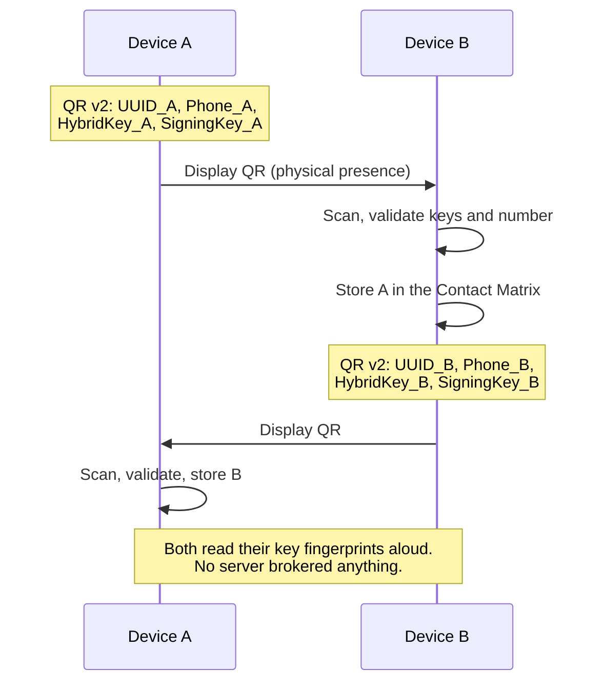

<!-- Engineered by uncoalesced -->
# Security protocol: trust no one

---

## 1. Threat model

The network carrying a message is not trusted with its contents. Impart's transport is the carrier SMS channel: the mobile operator and any SS7 intermediary. It is trusted to move ciphertext from A to B and nothing else. There is no Google infrastructure (no Firebase, no Cloud Functions, no FCM) and no Impart server anywhere in the path.

So anything that would mean something to an attacker, or to the carrier, never exists in plaintext outside the two phones. And because anyone who knows a phone number can text it, the receiving phone treats every incoming alert as hostile until it proves otherwise.

## 2. Identity

Every node has a version-4 UUID, generated on first launch. It is not derived from a phone number, email or device serial. A new UUID is a new identity, and every pairing has to be redone.

A node also holds two Tink keysets, both generated on first launch:

- A hybrid keyset (HPKE: X25519, HKDF-SHA256, AES-256-GCM). Alerts to this node are encrypted to its public half.
- A signing keyset (Ed25519). Every alert this node sends is signed with it.

Both keysets are stored in app-private preferences, encrypted by an AES key that lives in the Android Keystore (in secure hardware where the phone has it). The keysets are decrypted into app memory when used. The public halves travel in the QR code. The private halves never leave the phone.

## 3. The handshake

Trust is established one way only: scanning a QR code in person.



The QR payload is `{v: 2, uuid, phoneNumber, publicKey, signingKey}`. The phone number is typed in by the user on the My QR screen, because Android cannot read it reliably from the SIM. It has to be a full international number (`+`, country code, 8 to 15 digits). Short codes and local formats are refused on both sides, so a QR cannot point panics, or the automatic dead man's switch, at a premium-rate number.

When a QR is scanned:

- A v1 QR (no signing key) is refused with "update both phones".
- Keys that Tink cannot parse as the right type are refused.
- The node's own QR is refused.
- A new UUID is added.
- A known UUID with the same keys is a re-pair. The nickname is kept, the number is updated, and a revoked contact becomes active again.
- A known UUID with different keys is not written. The user sees a dialog with the old and new key fingerprints and decides. That is what a reinstall looks like, and it is also what a QR built to hijack an existing contact looks like.

Each node shows an 80-bit key fingerprint (SHA-256 over both public keys, five groups of four hex digits) under its QR and next to every contact. Reading it aloud while pairing confirms the QR really came from the phone in front of you.

Pairing is two-way: both phones scan each other.

## 4. Alerts

### 4.1 Payload

The plaintext of every alert, panic or acknowledgement, is a small JSON object with short keys to fit the SMS budget:

```json
{"v":2,"t":"P","from":"<sender uuid>","to":"<recipient uuid>","id":"<128-bit random, base64url>","ts":1790253160570,"lat":51.5,"lng":-0.12}
```

- `t` is `P` for a panic or `A` for an acknowledgement. An acknowledgement carries `ack`, the ID of the panic it answers.
- `lat` and `lng` are present only when the sender turned on location sharing.
- There is no phone number or public key in the payload. The receiver uses what it stored at pairing.

### 4.2 Sign, then encrypt

Send path:

1. Serialize the payload once. That string is the payload from here on.
2. Sign its UTF-8 bytes with the sender's Ed25519 key.
3. Join as `<base64 signature>.<payload>`.
4. Encrypt that to the recipient's hybrid public key with Tink HPKE.
5. Base64, prefix `IMPART_ALERT:`, and send as a multipart SMS from the default SMS SIM, with a sent-intent per part.

A worst-case panic, with coordinates at full precision, fits in four SMS parts. A unit test enforces this.

The signature covers the exact bytes that travel, so the receiver verifies what was sent and nothing is re-serialized. Encryption comes last, so the carrier sees neither the payload nor who signed it.

### 4.3 Receive path

`ImpartSmsReceiver` matches the prefix and ignores every other SMS. It does nothing at all if the node was wiped. Then, under `goAsync()` and a 30-second wake lock, `AlertVerifier` decides:

1. Decrypt with this node's hybrid key. Failure: unreadable.
2. Split the signature from the payload. A bare JSON plaintext is a v1 alert: outdated.
3. Parse the payload. Failure: malformed.
4. Find the sender by `from` among active contacts. Missing or revoked: unknown sender.
5. Verify the signature with the signing key stored for that contact. Failure: bad signature, which means someone is impersonating them.
6. Check `to` is this node. Otherwise: not for this node. This stops a trusted contact forwarding a third node's signed alert.
7. Check the time. More than 10 minutes in the future: rejected. More than 24 hours old: stale, reported and not raised.
8. Record `id` in the seen-alerts table. Already there: replayed.
9. Accepted. A panic raises the full-screen alarm and shows the delay if it arrived late. An acknowledgement posts a notification.

Every verdict other than acceptance posts a visible status notification. Nothing about the payload is trusted until step 5 passes, and an ID is only recorded once the alert has passed every other check.

The acknowledgement goes back to the contact's stored phone number, encrypted to the contact's stored key. Nothing in the incoming alert decides where it goes.

### 4.4 Why these primitives

HPKE gives every message a fresh ephemeral key, so a QR only carries public keys and watching the scan does not let anyone decrypt anything. The pre-shared-secret alternative was rejected for exactly that reason. HPKE alone does not authenticate the sender, because anyone with the recipient's public key can encrypt to it. That is why every alert is also signed with Ed25519, and why the verifier checks the signature against the key stored at pairing, never a key named inside the message.

## 5. What the carrier can and cannot see

This section is a security requirement in itself. An honest threat model does not overclaim.

The carrier, and any SMS or SS7 intermediary, can see:

- That the sender's number texted the receiver's number, and when.
- How many SMS parts it took.
- That the body starts with `IMPART_ALERT:`.

The carrier cannot see the contents, the sender's identity inside the envelope, whether it is a panic or an acknowledgement, or any coordinates.

Impart gives confidentiality and authenticity of content, not metadata privacy. Over SMS the metadata (two real phone numbers and the timing) is arguably more exposing than a push token would be. That is the trade for removing every server from the loop and getting a wake path Doze cannot throttle.

A copy of each alert also lands in the phone's normal Messages app, because Android stores texts for apps that are not the default SMS app. Those copies cannot be decrypted, and the replay defence makes them useless to re-send, but they do show who exchanged alerts with whom until the user deletes them.

## 6. Attack surface and mitigations

This review covers the build on branch `claude/impart-kotlin-refactor-t8fwjh`, dated 24 September 2026.

| Threat | Status | How |
|---|---|---|
| Attacker on the same Wi-Fi or LAN | Not applicable | No INTERNET permission, no socket, server, WebView, Bluetooth or local discovery. Nothing listens. |
| Forged panic from someone who has seen both QR codes | Fixed | Ed25519 signature checked against the key stored at pairing (§4.3 step 5) |
| Replay of a copied alert SMS (Messages inbox, backup, carrier) | Fixed | Unique ID recorded in `seen_alerts` for 48 hours, plus a 24-hour age limit |
| A trusted contact forwarding someone else's alert | Fixed | Signed `to` field must equal this node (§4.3 step 6) |
| ACK redirected to an attacker's number | Fixed | ACK uses the stored contact, never the payload |
| QR that reuses a contact's UUID with new keys | Mitigated | Nothing written until the user confirms with both fingerprints in front of them |
| QR that points panics at a premium short code | Fixed | Numbers must be full international numbers |
| Someone holding the unlocked phone | Mitigated | App lock: PIN on every start and after 30 s in the background. Four free attempts, then a lockout from 30 s doubling to 15 min. The duress PIN works at the lock screen, even during a lockout. |
| Coercion to open the app | Mitigated | Duress PIN wipes contacts, keys, seen IDs, scheduled work and every preference, then shows a decoy. It cannot remove the copies in the Messages app. |
| Screenshots, screen recorders, recent-apps preview | Fixed | `FLAG_SECURE` on both activities |
| Another app forging an `SMS_RECEIVED` broadcast | Fixed | Receiver requires `BROADCAST_SMS`, held only by the telephony stack |
| Contact names and numbers in logcat | Fixed | Logs carry redacted numbers (`***67`) and UUID prefixes only |
| Tampering with ciphertext in transit | Fixed | HPKE AEAD fails closed, and the signature covers the payload |
| A debug build replaced by an "update" | Open, documented | The debug keystore is public, so anyone can sign an APK that installs over a debug build. Use a release build signed with a private key for real use. The readiness card flags debug builds. |
| Reading the contact list on a rooted or seized phone | Open, documented | Room is sandboxed but not encrypted at rest. SQLCipher is on the roadmap. |
| Malware already on the phone (root, accessibility service) | Out of scope | Code running as the app, or driving its UI, can do anything the user can. |
| Number reassigned to a stranger | Mitigated | Panics to the old number cannot be decrypted by the new owner. Revoke the contact. |

## 7. Key rotation and revocation

There is no central authority, so rotating keys is a manual, mutual re-handshake. Reinstalling Impart generates new keys, and each counterpart sees the key-change dialog when they scan the new QR. Revoking a contact stops both directions at once: your panics no longer go to them, and theirs fail step 4 on your phone.
